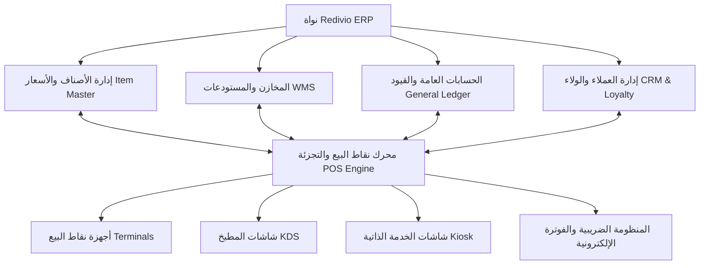
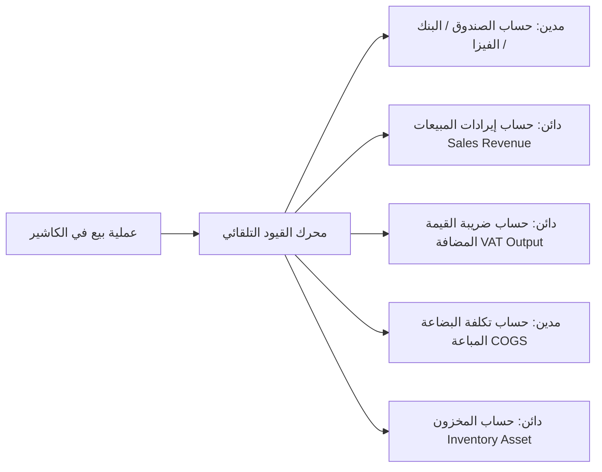

# المرجع الشامل لموديول نقاط البيع وتجارة التجزئة والمطاعم (Enterprise POS & Retail Module Specification)

> **الإصدار:** 2.0 Enterprise  
> **النظام:** Redivio ERP / Redivio Core  
> **حالة الوثيقة:** المرجع الفني والوظيفي المعتمد والشامل لكافة مزايا وإمكانيات موديول التجزئة ونقاط البيع (Retail & POS)  

---

## 📌 الفهرس العام للمرجع الشامل
1. [الرؤية العامة والهيكل المعماري للنظام (Architecture & Core Vision)](#1-الرؤية-العامة-والهيكل-المعماري-للنظام)
2. [إدارة الفروع، الأجهزة، والعتاد (Terminals, Branches & Hardware Support)](#2-إدارة-الفروع-الأجهزة-والعتاد)
3. [إدارة الورديات والرقابة النقدية (Shift & Cash Drawer Management)](#3-إدارة-الورديات-والرقابة-النقدية)
4. [إدارة الأصناف وكتالوج التجزئة المتقدم (Retail Item Master & Catalog)](#4-إدارة-الأصناف-وكتالوج-التجزئة-المتقدم)
5. [شاشة الكاشير وسرعة العمليات (Cashier Screen & High-Speed POS UX)](#5-شاشة-الكاشير-وسرعة-العمليات)
6. [طرق السداد المتعددة والفوترة الإلكترونية (Omni-Payments & E-Invoicing)](#6-طرق-السداد-المتعددة-والفوترة-الإلكترونية)
7. [محرك العروض الترويجية وبرامج الولاء (Promotions, Discounts & Loyalty Engine)](#7-محرك-العروض-الترويجية-وبرامج-الولاء)
8. [موديول المطاعم والكافيهات المتخصص (F&B, Table Layout & Kitchen Management)](#8-موديول-المطاعم-والكافيهات-المتخصص)
9. [التكامل اللحظي مع إدارة المستودعات (WMS & Inventory Real-Time Sync)](#9-التكامل-اللحظي-مع-إدارة-المستودعات)
10. [الربط المحاسبي التلقائي وشجرة الحسابات (Accounting & General Ledger Integration)](#10-الربط-المحاسبي-التلقائي-وشجرة-الحسابات)
11. [التقارير التحليلية، الرقابة، ولوحات القيادة (BI, Reporting & Audit Trail)](#11-التقارير-التحليلية-الرقابة-ولوحات-القيادة)
12. [الأمان، الصلاحيات، والتشغيل دون اتصال (Security & Offline Architecture)](#12-الأمان-الصلاحيات-والتشغيل-دون-اتصال)

---

## 1. الرؤية العامة والهيكل المعماري للنظام

تم تصميم موديول **Redivio POS & Retail** كمنظومة متكاملة فائقة السرعة تخدم قطاعين رئيسيين بكفاءة متساوية:
1. **قطاع التجزئة العام (General Retail):** السوبرماركت، الهايبرماركت، محلات الملابس والأحذية، متاجر الإلكترونيات، الصيدليات، ومتاجر التجزئة المتخصصة.
2. **قطاع الأغذية والمشروبات (Food & Beverage - F&B):** المطاعم السريعة (QSR)، المطاعم الفاخرة (Fine Dining)، الكافيهات، والمطابخ السحابية (Cloud Kitchens).

### الركائز المعمارية للنظام:
* **تعدد الشركات والفروع (Multi-OpCo & Multi-Branch):** دعم العمل لأكثر من شركة تابعة داخل نفس قاعدة البيانات مع عزل تام للبيانات، ودعم عدد لا نهائي من الفروع والمستودعات.
* **البنية الهجينة (Online / Offline Hybrid Mode):** استمرار نقطة البيع في تسجيل المبيعات وإصدار الفواتير وطباعتها حتى عند انقطاع الإنترنت بالكامل عبر تقنية IndexedDB / Local Storage والتزامن التلقائي الذكي فور عودة الاتصال دون تعارض.
* **سرعة الاستجابة الفائقة (Sub-second Response Time):** معالجة العمليات في أجزاء من الثانية لضمان سرعة تفريغ طوابير الانتظار (Queue Busting).
* **التوافق التشغيلي الكامل:** يدعم النظام العمل على أجهزة الكمبيوتر (Windows / Linux / macOS)، شاشات اللمس المخصصة (All-in-One POS)، الأجهزة اللوحية (iPads / Android Tablets)، وأجهزة نقاط البيع المحمولة (Smart Mobile POS).

---

## 2. إدارة الفروع، الأجهزة، والعتاد (Terminals, Branches & Hardware Support)

### 2.1 تعريف أجهزة نقاط البيع (POS Terminals)
* **ربط الجهاز بمستودع افتراضي خاص (Dedicated POS Plant & Bin):**
  * ينشئ النظام تلقائياً عند تعريف نقطة بيع جديدة مستودعاً فرعياً ورفاً مخصصاً (`POS-Plant` و `Default Storage Bin`)، مما يتيح تتبع البضاعة المسلوبة فوراً لكل كاشير.
* **تحديد طبيعة تشغيل النقطة (Terminal Mode):**
  * وضع التجزئة المباشرة (`DIRECT / RETAIL`).
  * وضع المطاعم والكافيهات (`RESTAURANT / F&B`).
  * وضع الخدمة السريعة (`QUICK SERVICE / DRIVE-THRU`).
* **مصفوفة الأجهزة المسموح بها (Allowed Devices & Terminals):**
  * تقييد دخول الكاشير فقط على الأجهزة المعتمدة برقم الجهاز أو Mac Address أو التراخيص المعتمدة لمنع الدخول غير المصرح به.

### 2.2 التوافق التام مع ملحقات وأجهزة الهاردوير (Hardware Peripherals)
* **طابعات الفواتير الحرارية (Receipt Thermal Printers):**
  * دعم بروتوكولات `ESC/POS` القياسية لمقاسات (80mm و 58mm).
  * خيارات التوصيل المتعددة: USB، الشبكة المحلية (Ethernet / IP Direct)، البلوتوث (Bluetooth)، والوايفاي (Wi-Fi).
  * دعم طابعات متعددة في نفس النقطة: طابعة الفاتورة للعميل، وطابعات منفصلة لأقسام التحضير (المطبخ، البار، الجريل).
* **قارئات الباركود (Barcode Scanners):**
  * دعم ماسحات 1D و 2D وقارئات QR Code فائقة السرعة.
  * دعم قارئات الباركود اللاسلكية والثابتة (Omnidirectional Hands-free Scanners).
* **أدراج النقدية الإلكترونية (Cash Drawers):**
  * فتح آلي متزامن مع أمر الطباعة عبر منفذ RJ11/RJ12 المتصل بالطابعة، أو عبر USB Trigger.
  * فتح يدوي محمي بصلاحية مدير وتسجيل وقت الفتح في سجل الرقابة (No-Sale Drawer Kick Audit).
* **شاشات عرض العميل (Customer Facing Displays - CFD / Pole Displays):**
  * شاشات 2-Line VFD Pole Displays لعرض اسم الصنف وسعره والإجمالي.
  * شاشات تابلت تفاعلية ثانية (Secondary Interactive Display) تعرض صورة الصنف، سلة المشتريات اللحظية، العروض الترويجية، والإيصال الإلكتروني كـ QR Code للمسح بالهاتف.
* **الموازين الإلكترونية المدمجة وموازين الباركود (Weighing Scales):**
  * الربط المباشر بالميزان عبر منفذ التسلسلي (Serial RS-232 / USB) لقراءة الوزن تلقائياً بمجرد وضع الصنف دون أي تدخل يدوي.
  * دعم قراءة وتفكيك باركود الموازين المطبوعة (Variable Weight Barcodes) بالتنسيقات القياسية (مثل بادئة 99 أو 21 التي تحمل كود الصنف والوزن أو السعر الصافي).
* **أجهزة الدفع الإلكتروني المصرفية (Payment Terminals - EDC / EFT-POS):**
  * الربط المباشر بنقاط البيع المصرفية لتمرير المبلغ تلقائياً من شاشة الكاشير إلى جهاز الفيزا لمنع أخطاء الإدخال البشري للقيم.

---

## 3. إدارة الورديات والرقابة النقدية (Shift & Cash Drawer Management)

منظومة صارمة للرقابة المالية لمنع العجز والتلاعب النقدي (Anti-Theft Cash Controls):

### 3.1 فتح الوردية (Opening Shift)
* تسجيل اسم الكاشير وتاريخ ووقت البدء بدقة بالغة.
* إدخال رصيد عهدة البداية (Opening Float / Opening Balance).
* شاشة تفقيط وعد الفئات النقدية (Denomination Counter): إدخال عدد العملات لكل فئة (مثال: 200 ج/ر، 100، 50، 20، 10، 5، الفكة المعدنية) ليقوم النظام بحساب الإجمالي آلياً والتأكيد عليه.

### 3.2 حركات الخزينة أثناء الوردية (Cash In / Cash Out Operations)
* **إيداع نقدي (Cash In):** لزيادة الفكة النقدية خلال الوردية مع تحديد السبب واسم المودع.
* **صرف نقدي (Cash Out / Petty Cash):** لدفع المصاريف النثرية الطارئة للفرع (نظافة، شحن، إكراميات، بوفيه)، مع إلزام الكاشير بإدخال سبب الصرف وتحديد مركز التكلفة، وإمكانية إرفاق صورة الإيصال.
* **سحب الفائض الآمن (Cash Drop / Safe Drop):** سحب المبالغ النقدية الكبيرة المتراكمة في الدرج وترحيلها إلى الخزينة الرئيسية المحصنة لتقليل المخاطر الأمنية في صالة البيع عند وصول الدرج إلى حد معين.

### 3.3 تقارير الرقابة اللحظية (X-Report)
* تقرير منتصف الوردية (X-Report): استعراض إجمالي المبيعات، المدفوعات كاش وفيزا، والمصروفات خلال الوردية الحالية في أي لحظة دون إغلاق الوردية، ومتاح فقط للمشرف أو المدير.

### 3.4 إغلاق الوردية والتقرير النهائي (Closing Shift & Z-Report)
* **الجرد الأعمى للنقدية (Blind Cash Reconciliation):**
  * إجبار الكاشير على عد النقدية الموجودة في الدرج وإدخال الفئات دون أن يظهر له في الشاشة المبلغ المتوقع دفترياً، لمنع تكييف الأرقام.
* **احتساب الفروقات الآلية (Over / Short Calculation):**
  * مقارنة النقدية الفعلية بالمبيعات المحققة والعهد:  
    $$\text{Expected} = \text{Opening Balance} + \text{Cash Sales} + \text{Cash In} - \text{Cash Out}$$
  * إظهار العجز (Short) أو الفائض (Over) بدقة.
* **إصدار وطباعة تقرير Z (Z-Report):**
  * تقرير إغلاق نهائي معتمد يحمل رقماً تسلسلياً فريداً غير قابل للتعديل، يتضمن ملخص المبيعات، الضرائب، المرتجعات، الخصومات، والمدفوعات حسب وسيلة الدفع.
* **توليد القيود المحاسبية للإغلاق:** ترحيل المبالغ تلقائياً إلى شجرة الحسابات (إثبات إيرادات الوردية، تحميل العجز على حساب عجز الكاشير أو تسوية الفائض).

---

## 4. إدارة الأصناف وكتالوج التجزئة المتقدم (Retail Item Master & Catalog)

### 4.1 إدارة الباركود والأكواد المتعددة
* **باركودات متعددة للصنف الواحد (Multiple Barcodes):** دعم أكثر من باركود دولي (EAN-13, UPC, Code 128) لنفس الصنف (مفيد عند تغيير الشركات المصنعة للباركود أو تعدد الموردين لنفس السلعة).
* **باركود الموازين الذكي (Price / Weight Embedded Barcodes):**
  * دعم التنسيقات العالمية (مثل: `20XXXXXWWWWWC` أو `99XXXXXPPPPP`):
  * قراءة كود الصنف واستخراج الوزن الصافي أو السعر الصافي تلقائياً وحساب الكمية والقيمة في الفاتورة بأقل من جزء من الثانية.
* **طباعة ملصقات الباركود والرفوف (Shelf & Price Tag Printing):**
  * تصميم وطباعة ملصقات الباركود بمقاسات مختلفة (Barcode Label Printing).
  * طباعة ملصقات أسعار الأرفف (Shelf Edge Labels) متضمنة السعر، الضريبة، الباركود، وتاريخ التحديث.

### 4.2 مصفوفة المتغيرات للأزياء والأحذية (Variant Matrix: Size, Color, Fit)
* دعم أصناف الموضة والأزياء بدقة عبر مصفوفة المقاسات والألوان:
  * الصنف الرئيسي (Parent Product) مثل "قميص كاجوال".
  * المتغيرات (Variants): أحمر-M، أحمر-L، أزرق-M، أزرق-L.
* لكل متغير باركود منفصل ورصيد مخزني مستقل وسعر بيع خاص إن لزم الأمر، مع إمكانية عرضها على الشاشة في شبكة سريعة (Grid Selection).

### 4.3 تتبع التشغيلات وتواريخ الصلاحية (Batch & Expiry Date Management)
* مثالي للصيدليات ومحلات السوبرماركت والمواد الغذائية:
  * تتبع رقم التشغيلة (Batch Number) وتاريخ انتهاء الصلاحية (Expiry Date).
  * البيع الإلزامي وفق سياسة ما ينتهي أولاً يخرج أولاً (FEFO - First Expire First Out).
  * تنبيه الكاشير ومنع بيع الأصناف المنتهية الصلاحية تماماً.
  * خصم الصنف من التشغيلة المحددة لضمان دقة أرصدة المستودعات.

### 4.4 تتبع الأرقام التسلسلية والضمانات (Serial Number Tracking)
* مثالي لمتاجر الإلكترونيات والأجهزة المنزلية والهواتف المحمولة:
  * إدخال أو مسح الرقم التسلسلي (IMEI / Serial Number) لكل جهاز مباع.
  * ربط الرقم التسلسلي بفاتورة العميل وبدء فترة الضمان تلقائياً، لمنع التلاعب في سياسات الاستبدال والإرجاع.

### 4.5 وحدات القياس المتعددة (Multi-UOM per Product)
* بيع الصنف بوحدات قياس مختلفة من نفس الشاشة:
  * مثال: بيع بالـ "قطعة"، "العلبة"، "الكرتونة"، أو "الدستة".
  * معامل تحويل تلقائي للخصم من المخزن بدقة (1 كرتونة = 24 قطعة).
  * تسعير وباركود مستقل لكل وحدة قياس.

### 4.6 الأصناف المجمعة والباقات (Kits, Combos & Bundles)
* إنشاء عروض وحزم ترويجية (مثل: شاشة + كابل HDMI مجاناً، أو وجبة كومبو = ساندوتش + بطاطس + مشروب).
* خصم المواد المكونة للباقة من المخزون بمجرد بيع الصنف المجمع.

---

## 5. شاشة الكاشير وسرعة العمليات (Cashier Screen & High-Speed POS UX)

صممت الواجهة للعمل تحت أقصى ضغوط البيع مع الحفاظ على أعلى معدلات الدقة والسهولة:

### 5.1 واجهة الاستخدام والبحث السريع
* **تصميم يدعم اللمس بالكامل (Touch-First Adaptive UI):** مساحات نقر كبيرة وألوان متناسقة تمنع الإجهاد البصري.
* **البحث متعدد المحاور (Omni-Search):**
  * بالباركود السريع عبر الماسح الضوئي.
  * بكود الصنف المالي أو اسم المنتج (عربي / إنجليزي) بالبحث الذكي والتقريبي (Fuzzy Search).
  * بالتصنيف والمجموعات مع صور ملونة عالية الوضوح للأصناف سريعة البيع.
* **أزرار الاختصار السريع (Quick Access Hotkeys):** أزرار مخصصة للأصناف التي لا تحتوي على باركود (مثل: عيش بلدي، كيس تسوق، خدمة إضافية).

### 5.2 إدارة الفواتير وعمليات السلة
* **تعليق واسترجاع الفواتير (Hold & Recall Orders):**
  * تعليق فاتورة العميل الحالي فوراً إذا تأخر في الدفع أو رغب في جلب صنف آخر، وخدمة العميل التالي دون إضاعة دقيقة واحدة.
  * إمكانية تعليق عدد لا نهائي من الفواتير مع كتابة اسم أو رقم تعريفي للفاتورة المعلقة.
* **تعديل الكميات السريع:**
  * اختصارات الكيبورد (مثل: `5 * Barcode` لإضافة 5 قطع دفعة واحدة).
  * أزرار الزيادة والنقصان السريعة أو إدخال الرقم يدوياً.
* **الخصومات المتقدمة (Line & Order Level Discounts):**
  * خصم على مستوى الصنف الفردي (نسبة مئوية % أو مبلغ نقدي ثابت).
  * خصم على إجمالي الفاتورة بالكامل.
  * تقييد صلاحية تطبيق الخصومات بنسب معينة، وإلزام طلب إذن المدير (Supervisor Approval) للخصومات الكبيرة مع تسجيل سبب الخصم.
* **إلغاء الأصناف والفواتير (Void Item / Cancel Order):**
  * إلغاء صنف محدد من السلة، أو إلغاء الفاتورة بالكامل قبل الدفع.
  * حماية الإلغاء بصلاحية مشرف لمنع سرقة الكاشيرين، وتسجيل كافة العمليات الملغاة في سجل الرقابة المشبوهة (Void Log).
* **إضافة ملاحظات خاصة للبند (Line Notes):** كتابة أي تنويهات تخص الصنف لتطبع في الفاتورة أو شاشة المطبخ.

### 5.3 منظومة المرتجعات والاستبدال المرنة (Returns & Exchanges)
* **الإرجاع برقم الفاتورة الأصلية (Invoice-Backed Returns):**
  * مسح باركود الفاتورة الأصلية لاستدعاء الأصناف المباعة، منع إرجاع الصنف أكثر من مرة، والتحقق من انتهاء مهلة الإرجاع القانونية.
* **الإرجاع الحر بدون فاتورة (Blind Return):**
  * متاح للمدراء فقط مع اشتراط تحديد العميل وسبب الإرجاع.
* **فحص وتوجيه البضاعة المرتجعة (Item Condition & Routing):**
  * بضاعة سليمة قابلة للبيع: تعاد تلقائياً إلى رصيد الرف المتاح للبيع.
  * بضاعة معيبة أو تالفة: توجه آلياً إلى مستودع الهوالك/التوالف (`Defects Bin`) مع خصم قيمتها المحاسبية.
* **وسائل رد المستحقات للعميل:**
  * رد نقدي (Cash Refund).
  * رد على البطاقة البنكية.
  * إصدار إشعار دائن / رصيد متجر (Store Credit / Voucher) لاستخدامه في مشتريات مستقبلية.

---

## 6. طرق السداد المتعددة والفوترة الإلكترونية (Omni-Payments & E-Invoicing)

### 6.1 السداد المجزأ والمتعدد (Split & Multi-Tender Payments)
* إمكانية دفع الفاتورة الواحدة بأكثر من وسيلة دفع في نفس الوقت:
  * جزء نقداً (Cash).
  * جزء ببطاقة ائتمان / فيزا (Credit/Debit Card).
  * جزء بنقاط الولاء (Loyalty Points Redemption).
  * جزء بكوبون خصم أو قسيمة هدايا (Gift Voucher).
  * الباقي على الحساب الآجل للعميل (On Account / Credit Customer).
* حاسبة الباقي النقدي التلقائية لمنع أخطاء الحساب اليدوي للكاشير.
* دعم الدفع عبر إنستاباي وتطبيقات المحافظ الإلكترونية (`InstaPay QR` / `E-Wallets`).

### 6.2 التوافق التام مع منظومات الفاتورة والإيصال الإلكتروني
* **منظومة الإيصال الإلكتروني (ETA E-Receipt - مصر):**
  * توافق تام مع بروتوكولات مصلحة الضرائب المصرية لربط نقاط البيع (POS ERP Integration).
  * تشفير الفواتير وإرسالها اللحظي عبر API المصلحة أو بنظام التجميع الدوري (Batch Upload).
* **الفاتورة المبسطة والإلكترونية (ZATCA Phase 1 & 2 - السعودية):**
  * توليد الرمز الشريطي المتوافق (`ZATCA Compliant QR Code`) بتنسيق TLV مشفر بـ Base64.
  * تضمين الحقول الإلزامية: اسم المورد، الرقم الضريبي، التاريخ والوقت، إجمالي الفاتورة، وقيمة الضريبة المضافة.
  * التشفير والتوقيع الرقمي (Cryptographic Stamp & Hash Chaining) وربط UUID فريد لكل إيصال.
* **تخصيص الفاتورة الحرارية بالكامل:**
  * رأس الفاتورة (اسم الشركة، اللوجو، الرقم الضريبي، السجل التجاري، رقم الفرع، رقم الهاتف).
  * جدول الأصناف بتفاصيل السعر والكمية والخصم والضريبة.
  * تذييل الفاتورة (سياسة الاستبدال والاسترجاع، رسائل الترحيب، وأكواد السوشيال ميديا).

---

## 7. محرك العروض الترويجية وبرامج الولاء (Promotions, Discounts & Loyalty Engine)

محرك مرن لإطلاق الحملات التسويقية لزيادة متوسط قيمة السلة (Basket Size):

### 7.1 أنواع العروض الترويجية الذكية
* **اشترِ X واحصل على Y مجاناً أو بخصم (Buy X Get Y - BOGO):**
  * مثال: اشترِ 2 قميص واحصل على الثالث مجاناً، أو اشترِ بيتزا واحصل على لتر بيبسي بخصم 50%.
* **عروض الكميات وأسعار الجملة (Tiered / Volume Discounts):**
  * مثال: سعر القطعة 10 جنيه، وعند شراء 5 قطع يصبح سعر القطعة 8 جنيه تلقائياً.
* **عروض باقات الوجبات والمجموعات (Bundle Pricing):**
  * تحديد سعر ثابت لمجموعة أصناف عند شرائها مجتمعة.
* **العروض المرتبطة بالفترة الزمنية والساعات السعيدة (Happy Hours & Flash Sales):**
  * تفعيل خصومات تلقائية خلال ساعات معينة من اليوم أو أيام محددة من الأسبوع (مثال: خصم 20% كل ثلاثاء من 4 إلى 7 مساءً).
* **أكواد الخصم والكوبونات (Promo Codes & Vouchers):**
  * تحديد شروط دقيقة للكود: الحد الأدنى لقيمة الفاتورة، الحد الأقصى لعدد مرات الاستخدام، تاريخ انتهاء الصلاحية، وقصر الكود على تصنيفات معينة.

### 7.2 برامج ولاء ومكافآت العملاء (Customer Loyalty Program)
* **تجميع النقاط (Points Accrual):**
  * منح العميل عدداً محدداً من النقاط مقابل كل جنيه/ريال يتم إنفاقه (مثال: 1 نقطة لكل 10 جنيه).
* **استبدال النقاط (Points Redemption):**
  * تحويل النقاط المجمعة إلى خصم نقدي فوري على الفاتورة الحالية أو إصدار قسيمة شراء.
* **مستويات وفئات العملاء (Customer Tiers):**
  * تصنيف العملاء تلقائياً حسب حجم إنفاقهم السنوي: (فضي، ذهبي، بلاتيني).
  * منح كل فئة نسبة خصم دائمة أو مضاعفة نقاط الولاء تلقائياً بمجرد التعرف على العميل في شاشة الكاشير.
* **ملف تعريف العميل (Customer Profile 360):**
  * تسجيل بيانات العميل، تاريخ آخر زيارة، إجمالي المشتريات، المفضلات، والرصيد المتاح.

---

## 8. موديول المطاعم والكافيهات المتخصص (F&B, Table Layout & Kitchen Management)

حل متكامل ومصمم خصيصاً لعمليات الضيافة المعقدة:

### 8.1 إدارة الطاولات والخريطة التفاعلية (Interactive Floor & Table Layout)
* **تصميم رسومي متعدد الأدوار (Multi-Floor Graphic Canvas):**
  * إمكانية رسم صالة المطعم وتوزيع الأدوار (الدور الأرضي، الصالة العائلية، الروف، التراس الخارجي).
  * توزيع الطاولات بأشكال مختلفة (دائرية، مربعة) مع تحديد إحداثياتها الدقيقة وعدد الكراسي المخصصة لكل طاولة.
* **مؤشرات الحالة اللحظية بالألوان للطاولات (Table Status Indicators):**
  * 🟢 **أخضر (Available):** طاولة فارغة ومستعدة لاستقبال عميل.
  * 🔴 **أحمر (Occupied):** طاولة مشغولة مع إظهار الفاتورة النشطة ومدة الجلوس.
  * 🟡 **أصفر (Reserved):** طاولة محجوزة مسبقاً مع اسم العميل وموعد الوصول.
  * 🔵 **أزرق (Cleaning):** الطاولة قيد التنظيف والتعقيم.
* **عمليات الطاولات المتقدمة:**
  * **نقل الطاولة (Move / Transfer Table):** نقل الطلب من طاولة إلى أخرى بنقرة واحدة وتحديث مواقع الخدمة.
  * **دمج الطاولات (Merge Tables):** دمج طلبات أكثر من طاولة في شيك واحد للمجموعات الكبيرة.
  * **تقسيم الفاتورة (Split Bill):**
    * تقسيم بالتساوي بين الضيوف (Split Equally).
    * تقسيم حسب الأصناف التي طلبها كل مقعد (Split by Seat / Item).

### 8.2 شاشات عرض المطبخ ونظام KDS (Kitchen Display System)
* **الاستغناء الكامل عن الأوراق وبونات المطبخ الضائعة:**
  * شاشات تفاعلية تعمل باللمس داخل المطبخ تعرض الطلبات فور تأكيدها من الكاشير أو الويتر.
* **توجيه الأصناف الذكي لمحطات التحضير (Station Routing):**
  * يرسل النظام صنف "ستيك اللحم" إلى شاشة محطة الجريل (Grill Station).
  * يرسل صنف "البيتزا" إلى شاشة محطة الفرن (Pizza Station).
  * يرسل "العصائر والكوكتيلات" إلى شاشة البار (Bar Station).
* **توقيتات ومراحل التحضير الذكية:**
  * حساب وقت الانتظار اللحظي لكل طلب (Preparation Timer).
  * التغيير اللوني التلقائي للتنبيه:
    * أخضر: طلب جديد.
    * برتقالي: اقتراب الحد الأقصى لوقت التحضير.
    * أحمر متوهج مع تنبيه صوتي: طلب متأخر عن وقت التسليم المحدد.
  * تحديث حالة الطلب من الشاشة: (قيد التحضير In Progress $\rightarrow$ تم التحضير Done $\rightarrow$ تم الاستلام Served).

### 8.3 هندسة الوصفات والخصم الآلي للمخزون (Recipe Engineering & BOM)
* **تفكيك الوجبات للمواد الخام الأولية (Raw Ingredients Deduction):**
  * عند بيع وجبة "برجر دبل": يقوم النظام آلياً في الخلفية بخصم (2 قطعة لحم بقر 150 جم + 1 خبز برجر + 2 شريحة جبنة شيدر + 20 جم صوص خاص + 30 جم خس وطماطم) من المستودع المخصص.
* **معالجة التعديلات والاستثناءات الذكية (Modifiers & Kitchen Notes):**
  * دعم الإضافات المدفوعة (Extra Cheese) مع إضافة قيمتها للفاتورة وخصم وزن الجبنة الإضافية من المخزون.
  * دعم الاستثناءات الذكية عبر المحرك اللغوي (مثال: عند كتابة ملاحظة "بدون بصل" أو "No Onions": يتعرف النظام على الكلمة ويستثني البصل تلقائياً من الخصم المخزني للوصفة لضمان دقة أرصدة التكلفة الفعالة).

### 8.4 أنماط الخدمة المتعددة
* **محلي (Dine-In):** طلبات الصالة مع ربط الطاولات والويترز.
* **سفري (Takeaway / To-Go):** طلبات الاستلام السريع مع إصدار رقم مناداة للعميل يظهر على شاشات انتظار العملاء الخارجية.
* **توصيل منازل (Home Delivery):**
  * تسجيل بيانات العميل وهواتفه وعناوينه المتعددة وسجل طلباته السابقة بمجرد إدخال رقم هاتفه.
  * تعيين الكباتن وسائقي التوصيل وتتبع فواتيرهم المعلقة حتى التحصيل وتوريد النقدية.
* **خدمة السيارات (Drive-Thru):** تسلسل سريع يبدأ من شاشة أخذ الطلب (Order Taker) إلى شاشة الدفع ثم شاشة الاستلام في ثوانٍ معدودة.

---

## 9. التكامل اللحظي مع إدارة المستودعات (WMS & Inventory Real-Time Sync)

القضاء التام على الفجوة بين المبيعات والمخازن:

### 9.1 الرصد المخزني اللحظي ومنع البيع بالسالب
* إظهار الرصيد المتاح للبيع على شاشة الكاشير لكل صنف في الوقت الفعلي.
* خيار تكويني صارم: إما **منع البيع بالسالب تماماً** وحظر إتمام الفاتورة إذا كان الرصيد صفراً، أو **السماح بالبيع بالسالب** للشركات التي تعتمد وصول الشحنات قبل تسجيل الفواتير دفترياً، مع إرسال إشعارات لمدير المخازن.

### 9.2 التحويلات المخزنية وإعادة تموين الفروع (POS Replenishment & Transfers)
* **طلب بضاعة من الفرع للمستودع الرئيسي (Requisition):**
  * إنشاء طلب احتياج بضائع مباشرة من شاشة نقطة البيع عند وصول الصنف إلى نقطة إعادة الطلب (Reorder Point).
* **إذن التحويل المخزني (Stock Transfer):**
  * خروج البضاعة من المستودع الرئيسي كـ "بضاعة في الطريق" (In-Transit).
  * استلام البضاعة في الفرع عبر فحص ومسح الباركود لتأكيد الكميات المستلمة وتحديث رصيد نقطة البيع تلقائياً، وإثبات أي عجز في الشحنة.

### 9.3 الجرد الدوري والمفاجئ لنقاط البيع (POS Cycle Counting)
* إمكانية عمل جرد سريع لصنف معين أو تصنيف بالكامل أثناء تشغيل الوردية دون إيقاف المبيعات.
* مقارنة الرصيد الفعلي بالرصيد الدفتري المسجل في النظام وإصدار تسويات الجرد (Inventory Adjustments) تلقائياً مع تحميل الفروقات على المتسبب.

---

## 10. الربط المحاسبي التلقائي وشجرة الحسابات (Accounting & General Ledger Integration)

تكامل تام ينقل العمليات التشغيلية إلى قيود محاسبية دون أي تدخل يدوي:

### 10.1 القيود التلقائية الناتجة عن نقاط البيع
1. **قيد المبيعات والضريبة:**
   * **مدين:** حساب الصندوق (للمبيعات النقدية)، أو حساب وسيط البنك (لمبيعات الفيزا والبطاقات)، أو حساب مديني العملاء (للمبيعات الآجلة).
   * **دائن:** حساب إيرادات مبيعات التجزئة.
   * **دائن:** حساب مصلحة الضرائب (ضريبة القيمة المضافة المحصلة - Output VAT).
2. **قيد تكلفة البضاعة المباعة (COGS Entry):**
   * **مدين:** حساب تكلفة البضاعة المباعة (Cost of Goods Sold).
   * **دائن:** حساب مخزون بضاعة التجزئة (Inventory Asset) بالتكلفة الفعلية (وفق المتوسط المرجح WAC).
3. **قيد عمولات نقاط البيع البنكية (Bank MDR Fees):**
   * خصم عمولة الدفع الإلكتروني تلقائياً وترحيلها إلى حساب مصروفات بنكية وإيداع الصافي في حساب البنك.
4. **قيد إغلاق الوردية وتسوية الفروقات (Over/Short):**
   * إثبات عجز الصندوق في حساب "ذمم موظفين - عجز كاشير" أو إثبات الفائض في حساب "إيرادات أخرى متنوعة".
5. **مراكز التكلفة والأرباح (Cost Centers):**
   * ربط كل عملية بيع بمركز تكلفة الفرع ونقطة البيع بدقة لتحليل ربحية كل فرع على حدة (Branch P&L).

---

## 11. التقارير التحليلية، الرقابة، ولوحات القيادة (BI, Reporting & Audit Trail)

ترسانة متكاملة من التقارير والتحليلات لدعم اتخاذ القرارات:

### 11.1 تقارير المبيعات الشاملة
* **المبيعات حسب الفترات:** يومي، أسبوعي، شهري، ومقارنات سنوية.
* **المبيعات حسب الأبعاد:**
  * المبيعات حسب الفرع ونقطة البيع.
  * المبيعات حسب الكاشير والويتر.
  * المبيعات حسب الصنف والمجموعة والتصنيف التجاري والمورد.
* **الخريطة الحرارية لساعات الذروة (Hourly Sales Heatmap):**
  * تحليل المبيعات حسب ساعات اليوم وأيام الأسبوع لتحديد فترات الذروة وتنظيم جداول عمل الموظفين ومواعيد العروض.

### 11.2 تحليلات الربحية وهوامش الربح
* تقرير إجمالي الربح الفعلي (Gross Profit Margin) لكل صنف ومجموعة بعد مقارنة سعر البيع بالتكلفة الحقيقية (COGS).
* تقرير مساهمة الأصناف في الأرباح (Margin Contribution Analysis).

### 11.3 تحليلات سلة المشتريات وسلوك المستهلك
* **متوسط قيمة الفاتورة (Average Basket Size / Ticket Size).**
* **متوسط عدد الأصناف في الفاتورة (Units per Transaction - UPT).**
* **تحليل الأصناف المرتبطة معاً (Market Basket Analysis):** معرفة الأصناف التي يشتريها العملاء سوياً لتنظيم أماكن العرض على الأرفف أو إطلاق باقات مجمعة.
* **تصنيف المنتجات ثلاثي الأبعاد (ABC Inventory Analysis):**
  * فئة (A): الأصناف عالية القيمة سريعة الدوران (80% من الإيرادات).
  * فئة (B): أصناف متوسطة الأهمية.
  * فئة (C): أصناف بطيئة الحركة والراكدة لاتخاذ قرارات التصفية.

### 11.4 سجلات الرقابة وتدقيق التلاعب المالي (Fraud Detection & Audit Logs)
* تقرير العمليات المشبوهة والملغاة (Suspicious Void & Cancellation Report).
* تقرير فتح درج النقدية دون بيع (No-Sale Drawer Opens).
* تقرير الخصومات الاستثنائية والخصومات اليدوية ونسبتها إلى إجمالي المبيعات.
* تقرير المرتجعات حسب الكاشير والفرع وأسباب الإرجاع.

---

## 12. الأمان، الصلاحيات، والتشغيل دون اتصال (Security & Offline Architecture)

### 12.1 هيكل الصلاحيات الدقيق وموافقة المشرفين (Role-Based Permissions)
* فصل صارم بين دور (الكاشير، مشرف الوردية، مدير الفرع، المدير المالي):
  * **عمليات تتطلب إذن المشرف (Supervisor Override):**
    * تطبيق خصم يتجاوز النسبة المصرح بها للكاشير.
    * إلغاء بند بعد إرساله للمطبخ أو حفظه.
    * إلغاء الفاتورة بالكامل.
    * فتح درج النقدية يدوياً بدون عملية بيع.
    * تعديل سعر الصنف في الشاشة.
    * إعادة طباعة الفاتورة أكثر من مرة.

### 12.2 العمل في وضع عدم الاتصال (Offline-First Resilient Architecture)
* **تخزين محلي آمن (Client-Side Local Storage & IndexedDB):**
  * تحميل كتالوج الأصناف والأسعار والعملاء محلياً على المتصفح أو التطبيق.
* **استمرار البيع الكامل دون إنترنت:**
  * تسجيل الفواتير، تطبيق الخصومات، احتساب الضرائب، وإصدار وطباعة الإيصال الحراري دون انقطاع حتى لو انقطع الإنترنت لساعات طويلة.
* **محرك المزامنة الذكي (Conflict-Free Sync Engine):**
  * بمجرد عودة الاتصال بشبكة الإنترنت، يقوم النظام في الخلفية برفع ومزامنة جميع الفواتير وحركات النقدية مع الخادم السحابي بدقة، وتحديث أرصدة المخازن والقيود المحاسبية تلقائياً دون أي تكرار أو تعارض في البيانات.

### 12.3 حماية البيانات ومعايير الدفع (Compliance & Security)
* دعم المعايير العالمية لحماية بيانات البطاقات المصرفية (`PCI-DSS Compliant`).
* تشفير قواعد البيانات والاتصالات عبر بروتوكولات `TLS 1.3 / HTTPS`.
* تسجيل تفاصيل كل حركة (Timestamp, IP Address, Device Fingerprint, User ID).

---

## ملخص القيمة التشغيلية لموديول Redivio POS & Retail

| المحور | القيمة التشغيلية المضافة |
| :--- | :--- |
| **السرعة والكفاءة** | القضاء على طوابير الانتظار ومعالجة الفاتورة في أقل من 3 ثوانٍ مع دعم الاختصارات واللمس. |
| **الرقابة المحكمة** | منع السرقة والتلاعب النقدي بالجرد الأعمى وتقارير الرقابة اللحظية وتتبع العمليات الملغاة. |
| **إدارة المخزون** | خصم لحظي للأصناف والوصفات الخام ومنع العجز وتتبع تواريخ الصلاحية والمقاسات والأرقام التسلسلية. |
| **الامتثال الضريبي** | توافق كامل 100% مع الفاتورة الإلكترونية والإيصال الإلكتروني في مصر وهيئة الزكاة والضريبة (ZATCA) في السعودية. |
| **التكامل المحاسبي** | توليد فوري للقيود اليومية ومراكز التكلفة، ليرى المدير المالي أرباح كل فرع في نفس اللحظة. |
| **مرونة الأعمال** | يعمل دون انترنت ويناسب متاجر التجزئة والسوبرماركت والأزياء والمطاعم والكافيهات بنفس القوة. |
